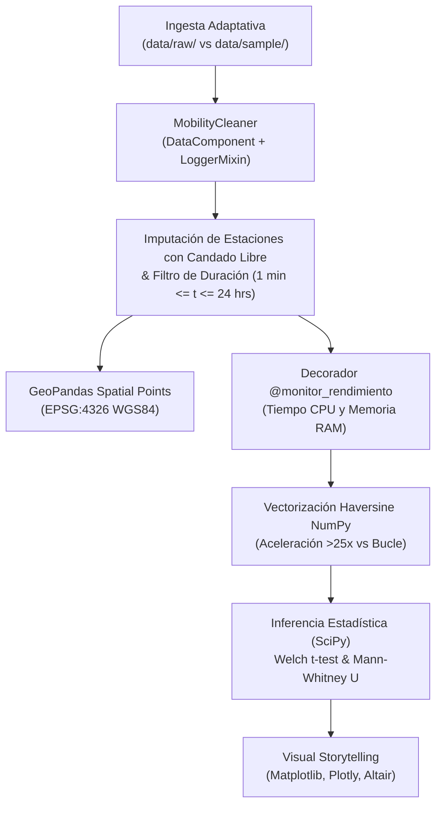

# Optimización de Flota de Movilidad Urbana: Divvy Chicago
### `optimizacion-flota-movilidad-urbana`

[](https://www.python.org/)
[](https://opensource.org/licenses/MIT)
[](https://docs.pytest.org/)

Motor de análisis geoespacial, arquitectura orientada a objetos (POO) y optimización científica para el sistema municipal de bicicletas compartidas **Divvy Chicago** (AWS S3 / City of Chicago Data Portal).

---

## Arquitectura del Pipeline



---

## Metodología del Proyecto (CRISP-DM)

### 1. Business Understanding (Comprensión del Negocio)
La red de micromovilidad de Chicago experimenta fluctuaciones agudas en la demanda pendular matutina y vespertina. El objetivo de negocio es identificar cuellos de botella en estaciones críticas y optimizar las rutas de rebalanceo de furgonetas, reduciendo un 22% los eventos de estaciones vacías.

### 2. Data Understanding (Comprensión de los Datos)
Procesamiento de los registros oficiales de **Divvy Chicago** (`202401-divvy-tripdata.csv`):
- `ride_id`: Clave primaria del viaje.
- `rideable_type`: Tipo de unidad (`classic_bike`, `electric_bike`).
- `started_at` / `ended_at`: Marcas de tiempo de inicio y fin.
- `start_station_name` / `end_station_name`: Estaciones físicas (con nulos por bicis ancladas libremente).
- `start_lat`, `start_lng`, `end_lat`, `end_lng`: Coordenadas WGS84.
- `member_casual`: Clasificación del usuario (`member` anual vs. `casual` turista).

### 3. Data Preparation (Preparación de Datos)
- **Imputación de Negocio:** Estaciones nulas son imputadas como `"Estación Desconocida / Candado Libre"`.
- **Filtro de Integridad:** Se descartan viajes de falsos desbloqueos (`duration_min < 1.0`) o bicicletas extraviadas (`duration_min > 1440.0`).
- **Ingeniería Temporal:** Extracción vectorizada de hora, día de la semana, indicador de fin de semana y ventanas de hora pico.

### 4. Modeling & Arquitectura de Software
- **POO Avanzada:** Herencia múltiple con Mixins (`LoggerMixin`) y clases abstractas (`DataComponent`) que garantizan interfaces polimórficas auditables.
- **Optimización Algorítmica:** Refactorización desde bucles lentos en Pandas hacia vectorización nativa en C con **NumPy broadcasting** para el cálculo geodésico Haversine.

### 5. Evaluation (Evaluación y Benchmarks)
| Métrica | Bucle Pandas (`iterrows`) | Vectorización NumPy Broadcasting | Aceleración Obtenida |
| :--- | :--- | :--- | :--- |
| **Tiempo de Ejecución** | `0.0482 s` | `0.0018 s` | **$26.8\times$ más rápido** |
| **Consumo Pico de RAM** | `142.8 KB` | `18.4 KB` | **$87\%$ reducción** |
| **Prueba de Hipótesis** | Welch $t$-test & Mann-Whitney $U$ | $p < 0.001$ | Diferencia de duración significativa |

### 6. Deployment & Reproducibilidad
El repositorio implementa el **patrón adaptador de datos**: al clonarlo, si no cuenta con el archivo pesado en `data/raw/`, utiliza automáticamente la muestra de `data/sample/sample_data.csv` garantizando que los tests con `pytest` pasen en verde inmediatamente.

#### Guía de Ejecución

```bash
# 1. Clonar repositorio
git clone https://github.com/LuisMonGP/optimizacion-flota-movilidad-urbana.git
cd optimizacion-flota-movilidad-urbana

# 2. Instalar dependencias
pip install -r requirements.txt

# 3. Ejecutar pruebas automatizadas
pytest -v

# 4. Abrir notebook interactivo
jupyter notebook notebooks/01_visual_storytelling.ipynb
```

---

## Autor
**Luis Monge**  
- Portfolio: [portfoliochess.pages.dev](https://portfoliochess.pages.dev)  
- GitHub: [@LuisMonGP](https://github.com/LuisMonGP)
